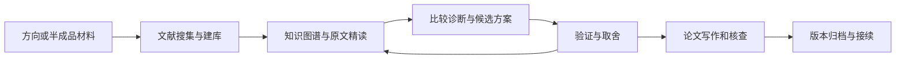

# ResearchAtlas · 科研证据工作流

从一个研究方向，或已有的半成品论文、文献、代码和结果，接续到可追溯的科研工作流。中文优先，适配具备对应能力的研究代理。

**当前版本：1.3.0-beta.1，公开 Beta，MIT。** 仓库品牌为ResearchAtlas；安装和调用的Skill标识为`research-evidence-workflow`。

## 能做什么

- 接收本地 PDF、文件夹或 ZIP，记录来源、版本、重复、缺件和阅读状态。
- 创建文献库和知识图谱，保存原文页码、锚点、文件指纹、查询与审阅记录。
- 将历史和新增文献放在同一范围比较，区分可以直接修订的内容与需要验证的改进。
- 保存研究阶段、决定、材料及代码，打包移交并在接收端回放证据。
- 按学位论文或期刊论文分流，衔接规范、写作、引用核查和归档。



已有项目从当前阶段继续；全库考量不等于全部全文已读，下载、索引、回放和科学支持分别记录。模型负责理解与规划，宿主提供实际文件、检索和执行工具。

## 安装与开始

需要 Python **3.10+**。核心工具使用标准库；PDF解析、原页渲染、语义检索按需增加依赖。先下载本仓库ZIP并解压，或克隆：

```text
git clone https://github.com/zhaohongshuai425-coder/ResearchAtlas.git
cd ResearchAtlas
python -B -X utf8 install.py --verify-only
python -B -X utf8 install.py --target codex
```

Codex中使用：

```text
$research-evidence-workflow
我的研究方向是……。先询问文献来源方式，再按当前阶段推进。
```

已有半成品时：

```text
$research-evidence-workflow
请读取我提供的初稿、代码和结果，核对现状，列出直接修订项和需要验证的改进项。
```

已有受管安装用`--upgrade`；检测到用户修改时安装器会停止替换。`--status`查看状态，`--rollback`回退。模型、密钥及客户端需由使用者配置。

## 其他宿主

| 宿主 | 入口 | 验证范围 |
|---|---|---|
| Codex | `install.py --target codex`，`$research-evidence-workflow` | 原生发现及本地工具已验证；完整研究质量依任务核验 |
| DeepSeek普通对话 | 复制`DeepSeek_直接复制使用.txt` | 依据该界面实际附件/工具能力工作 |
| OpenCode | `install.py --target opencode --project <已有项目>` | 目录与工具适配；真实模型闭环待使用者验收 |
| DeepSeek Harness | `install.py --target harness --project <已有项目>` | Skill目录与只读JSON桥适配；完整原生模型闭环待验收 |
| 其他Harness | [只读工具接口](research-evidence-workflow/references/harness-tools.md) | 宿主负责调用函数及回传结果 |

普通聊天不能凭一个本机路径读取磁盘或持久建库。完整平台说明见[platforms.md](research-evidence-workflow/references/platforms.md)和[harness.md](research-evidence-workflow/references/harness.md)。

## 本地工具

```text
python -B -X utf8 research-evidence-workflow/scripts/workflow.py doctor
python -B -X utf8 research-evidence-workflow/scripts/workflow.py brief status --state <项目>/research_state.json
python -B -X utf8 research-evidence-workflow/scripts/workflow.py local-ingest --help
```

输入来源、收件和续跑示例见[快速开始](docs/quickstart.md)；完整研究链见[workflow.md](research-evidence-workflow/references/workflow.md)。

## 学位排版预设

公开包仅提供可覆盖的[文字排版预设](research-evidence-workflow/scripts/tools/references/学位论文默认格式_沈阳农业大学本地版.md)，不包含原学校Word模板。使用者提供的学校/期刊规范优先；预设不证明符合任何学校的现行标准。正式Word版面仍需生成、渲染和检查。

## 验证与维护

```text
python -B -X utf8 run_tests.py
python -B -X utf8 build_release.py --output ../research-evidence-release --zip
```

测试使用临时合成材料，不调用模型或付费API。当前验收范围和限制见[验证说明](docs/validation.md)。GitHub Actions配置了Windows/Linux、Python3.10/3.12测试矩阵；只有实际完成的CI运行才算相应环境通过。

修改仓库后先构建新发行目录再安装；文件清单用于检查字节变化，不是发布者签名。[贡献说明](CONTRIBUTING.md)给出维护步骤。

## 许可证与来源

本项目自有代码和说明采用[MIT](LICENSE)。参考工作流资源包括K-Dense的Scientific Agent Skills；已保留其署名、MIT声明及论文引用，见[第三方说明](THIRD_PARTY_NOTICES.md)。外部软件、模型、论文和用户材料按各自条款使用；仓库不捆绑这些内容。
